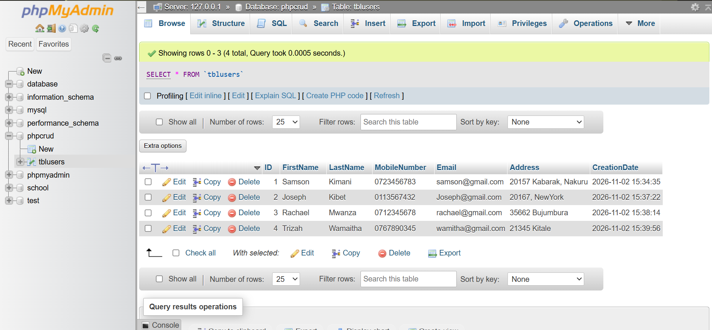

# PHP CRUD User Management System

A web-based user management application developed using PHP and MySQL. It allows users to create, view, update, and delete user records.

## Application Preview

The application homepage displays registered users and provides options to view, edit, and delete records.



## Database Preview

User information is stored in a MySQL database named `phpcrud`, using the `tblusers` table.


## Features

- Add new user records.
- View all registered users.
- View individual user details.
- Edit existing user information.
- Delete user records.
- Input validation and prepared SQL statements.

## Technologies Used

- PHP
- MySQL
- HTML
- CSS
- XAMPP

## Project Structure

```text
phpcrud/
├── screenshots/
│   ├── application-records.png
│   └── database-records.png
├── dbconnection.php
├── functions.php
├── index.php
├── insert.php
├── read.php
├── edit.php
├── delete.php
├── database.sql
├── style.css
└── README.md
```

## Installation and Setup

### Requirements

- XAMPP
- Web browser

### 1. Project Setup

Place the project folder inside:

`C:\xampp\htdocs\`

### 2. Start XAMPP

Start Apache and MySQL from the XAMPP Control Panel.

### 3. Database Setup

1. Open [phpMyAdmin](http://localhost/phpmyadmin).
2. Open the SQL tab.
3. Execute the contents of `database.sql`.
4. Confirm that the `phpcrud` database and `tblusers` table exist.

### 4. Run the Application

Open:

[http://localhost/phpcrud/](http://localhost/phpcrud/)

## Database Configuration

| Setting  | Value     |
| -------- | --------- |
| Host     | localhost |
| Username | root      |
| Password | Blank     |
| Database | phpcrud   |

Update `dbconnection.php` if your MySQL configuration is different.

## CRUD Operations

| Operation | Description           |
| --------- | --------------------- |
| Create    | Add a new user        |
| Read      | View user records     |
| Update    | Edit user information |
| Delete    | Remove a user record  |

## Developer

GitHub: [kiplangate-max](https://github.com/kiplangate-max)

---

_Developed as part of Web Application Development coursework._
